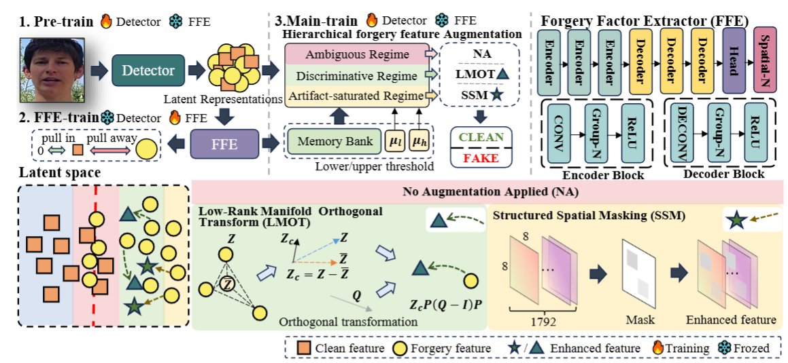

## Navigating Latent Forgery Manifold: Adaptive Hierarchical Feature Augmentation for Generalizable Face Forgery Detection

### 🌱 1. Train Detectors

Detector training follows the standard DeepfakeBench training pipeline.  
Please refer to the official DeepfakeBench repository for detector training and dataset preprocessing:

https://github.com/SCLBD/DeepfakeBench.git

### 🚀 2. Prepare Our Training Files

Place the provided `detectors/` and `config/` directories into the DeepfakeBench project directory.

The resulting structure should look like:

DeepfakeBench/
├── detectors/
├── config/
├── training/
├── dataset/
└── ...

```
python training/train.py --detector_path ./training/config/detector/efficientnetb4.yaml --train_dataset 'FaceForensics++' --test_dataset 'Celeb-DF-v2' 'DFDCP' --no-save_ckpt --no-save_feat

```

### 3. The framework of proposed method

